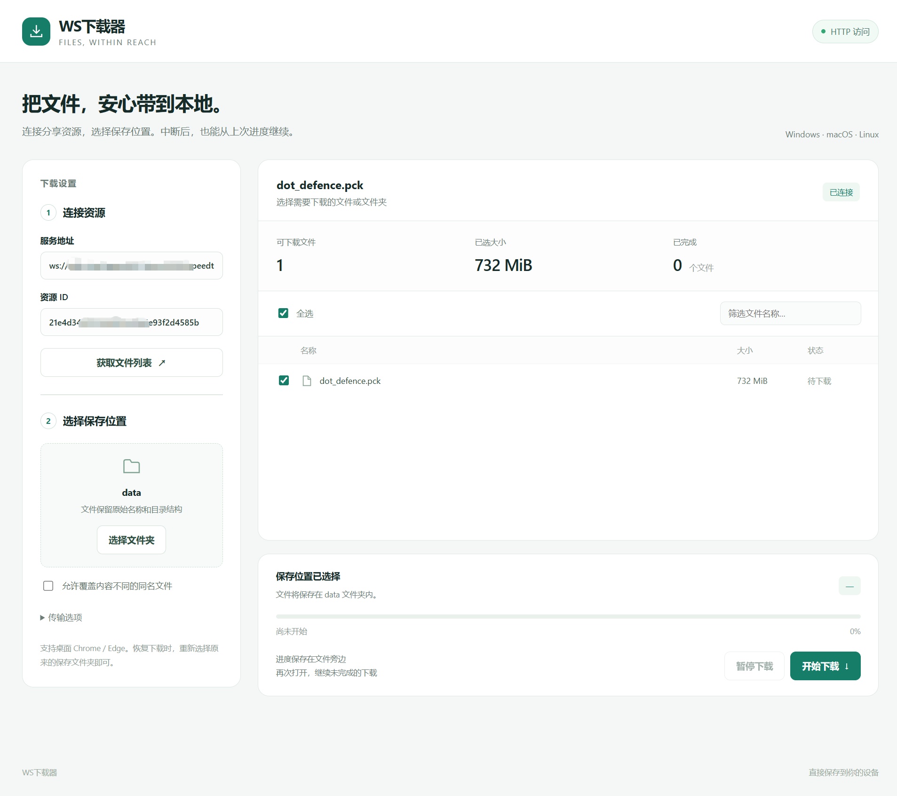

# ws-file-share

通过浏览器下载服务器上的文件或整个目录，支持选择部分文件、暂停和断点续传。

在存放文件的电脑上运行服务，接收者用桌面 **Chrome / Edge** 打开页面、选择保存文件夹即可下载。服务端支持 Windows、Linux 和 macOS；使用已编译程序时，无需安装 Go、Node.js 或浏览器扩展。

目录下载保留原有结构，支持空目录、空文件和隐藏文件。软链接会下载其指向的实际内容。



## 快速开始

### 1. 启动服务

准备好与你的系统匹配的 `ws-downloader` 和 `cli` 两个程序，进入它们所在的目录。Windows 的文件名带 `.exe`。如果从源码开始，请先按[开发文档](docs/development.md#从源码编译)编译，再进入生成的 `dist` 目录。

**Windows / PowerShell：**

```powershell
.\ws-downloader.exe init
.\ws-downloader.exe serve
```

**Linux / macOS：**

```sh
./ws-downloader init
./ws-downloader serve
```

`init` 在当前目录生成 `config.yaml`，不会覆盖已有配置。`serve` 启动后请保持终端运行；按 `Ctrl+C` 停止服务。以后启动只需执行 `serve`。

### 2. 添加要分享的文件

在同一台电脑上另开一个终端，进入程序所在目录，添加文件或文件夹。

**Windows / PowerShell：**

```powershell
.\cli.exe add "D:\Photos"
.\cli.exe add "D:\Downloads\archive.zip"
```

**Linux / macOS：**

```sh
./cli add "/data/photos"
./cli add "/data/archive.zip"
```

添加时会预先计算文件的 SHA-256 并保存到本地缓存，首次添加大文件或大目录可能需要等待。命令提示「校验准备完成」后，复制输出 JSON 中的 **`id` 值**，下载时需要填写。重复添加同一路径会返回相同 ID，并复用未变化文件的缓存。

### 3. 在浏览器中下载

先在运行服务的电脑上打开 **http://127.0.0.1:8080**：

1. 填入刚才的资源 ID，点击「获取文件列表」。服务地址通常无需修改。
2. 勾选需要下载的文件或目录。
3. 点击「选择文件夹」，选择接收位置并允许浏览器读写。
4. 点击「开始下载」。

目录会保留原名称，例如分享 `photos`，会在所选文件夹内生成 `photos/`。分享单个文件时保留文件名。

也可以把 ID 放入链接，打开后自动填入：

```text
http://127.0.0.1:8080/?id=资源ID
```

**从其他电脑访问时，`127.0.0.1` 指向接收者自己的电脑。** 请按下一节通过 HTTPS 域名或局域网地址访问服务。

## 使用 Docker

本机安装 Go 1.25 或以上版本、[just](https://github.com/casey/just) 和 Docker 后，在仓库根目录执行：

```sh
just docker
```

命令会先在本机编译 Linux 静态程序，再复制进镜像，默认镜像名为 `wingao/ws-file-share:latest`、架构为 `amd64`。ARM64 使用 `just docker wingao/ws-file-share:arm64 arm64`。更多构建选项见[开发文档](docs/development.md#docker-镜像)。

以下以 Linux/macOS 为例。将 `/path/to/files` 替换为宿主机上需要分享的目录：

```sh
mkdir -p docker-config
docker run -d --name ws-file-share \
  --user "$(id -u):$(id -g)" \
  -p 8080:8080 \
  -v "$(pwd)/docker-config:/config" \
  -v "/path/to/files:/data:ro" \
  wingao/ws-file-share:latest
```

Windows / PowerShell 使用 Docker Desktop 的 Linux 容器模式，例如：

```powershell
New-Item -ItemType Directory -Force docker-config
docker run -d --name ws-file-share -p 8080:8080 -v "${PWD}/docker-config:/config" -v "D:/Photos:/data:ro" wingao/ws-file-share:latest
```

首次启动会在 `docker-config` 中生成 `config.yaml`，已有配置会保留。容器默认下载监听地址是 `0.0.0.0:8080`；如果挂载已有配置，也需使用该地址，才能通过端口映射访问。

在容器内添加分享，复制输出的资源 ID，再打开宿主机的 `http://127.0.0.1:8080` 下载：

```sh
docker exec ws-file-share cli add /data
docker exec ws-file-share cli list
```

添加资源时使用**容器内路径**，例如 `/data`。配置必须挂载整个目录到 `/config`，才能正常保存和重载；分享目录可只读挂载。管理端口只在容器内监听，不需要映射 `8081`。

```sh
docker exec ws-file-share cli reload   # 修改配置后重载
docker logs -f ws-file-share          # 查看日志
docker restart ws-file-share         # 修改监听地址后重启
docker stop ws-file-share            # 停止服务
```

从其他电脑访问容器服务时，仍需按下文设置 HTTPS 或局域网 HTTP 的浏览器权限。

## 让其他电脑访问

### 通过 HTTPS 域名访问

已有 HTTPS 入口时，接收者可以打开带资源 ID 的链接：

```text
https://downloads.example.com/?id=资源ID
```

页面会自动使用对应的 WSS 地址。HTTPS 入口需要支持 WebSocket 转发，证书由入口代理管理。

**只代理下载端口 `8080`，管理端口 `8081` 留给服务器本机的 CLI 使用。** 当前分享没有密码或 Token 认证，请只添加你希望开放下载的资源。

### 在局域网中使用 HTTP

本机的 `http://localhost`、`http://127.0.0.1` 可以直接选择保存文件夹。通过局域网 IP 打开的 HTTP 页面，默认无法使用该功能。

如果需要通过局域网 HTTP 访问：

1. 把 `config.yaml` 的 `listen` 改为服务器的局域网地址，例如 `"192.168.1.100:8080"`，然后重启服务，确保接收端能访问此端口。`admin_listen` 保持本机回环地址。
2. 在接收者浏览器的地址栏打开对应设置：

   | 浏览器 | 设置地址 |
   | --- | --- |
   | Chrome | `chrome://flags/#unsafely-treat-insecure-origin-as-secure` |
   | Edge | `edge://flags/#unsafely-treat-insecure-origin-as-secure` |

3. 在 **Insecure origins treated as secure** 中填写页面地址，如 `http://192.168.1.100:8080`。包含协议和端口，不带路径；设为 **Enabled**，点击 **Relaunch** 重启浏览器。
4. 重新打开该页面，选择保存文件夹并授权。


该设置需要每台接收电脑单独操作，只把指定来源视为安全上下文；HTTP/WS 数据仍然是明文。参见 [Chromium 说明](https://www.chromium.org/Home/chromium-security/deprecating-powerful-features-on-insecure-origins/)。

## 暂停、续传与同名文件

点击「暂停下载」后，可以稍后继续；关闭页面后，重新打开同一资源并选择**原来的保存文件夹**即可恢复。中断或合并失败时，已有有效分片会保留。

下载期间，目标文件旁会出现以下临时文件：

```text
archive.zip.0._part
archive.zip.1._part
archive.zip._part.json
```

**需要续传时，请保留这些文件和 JSON 记录。** 下载完成并校验成功后，程序会自动清理。合并时分片和完整文件会同时存在，请预留足够磁盘空间。

遇到同名文件时，内容一致会自动跳过；内容不同则默认报错。确认可以替换后，再勾选「允许覆盖内容不同的同名文件」。

下载期间请尽量保持源文件不变。源文件被修改或删除，可能导致下载或最终校验失败。

## 管理分享与修改配置

管理命令在**运行服务的电脑上**执行。以下使用 Linux/macOS 写法；Windows / PowerShell 将 `./cli` 换为 `.\cli.exe`。

| 操作 | 命令 |
| --- | --- |
| 添加文件或目录 | `./cli add "/path/to/file-or-folder"` |
| 查看已分享资源及 ID | `./cli list` |
| 移除分享 | `./cli remove 资源ID` |
| 手动重载配置 | `./cli reload` |
| 查看命令帮助 | `./cli add --help` |

`remove` 只移除分享配置，不删除源文件。服务运行时，`add`、`remove` 会自动通知它重载配置，`add` 还会等待校验缓存准备完成。服务未运行时，`add` 会直接在本机计算并保存缓存，下次启动即可使用。

所有命令默认使用当前目录的 `config.yaml`。使用其他配置文件时，每次操作都指定同一个路径，例如：

```sh
# 服务端终端
./ws-downloader serve --config ./other/config.yaml

# 另一个终端
./cli add "/data/photos" --config ./other/config.yaml
```

编辑 `init` 生成的配置即可，完整字段见 [config.example.yaml](config.example.yaml)。常用设置如下：

| 配置项 | 默认值 | 什么时候需要修改 |
| --- | --- | --- |
| `listen` | `127.0.0.1:8080` | 修改下载端口，或让其他机器直接访问后端 |
| `admin_listen` | `127.0.0.1:8081` | 修改本机管理端口；CLI 会自动使用它 |
| `ws_path` | `/ws` | 自定义下载连接的路径，例如 `/download/socket` |
| `client_ws_url` | `""` | 页面需要连接另一主机或代理地址时填写完整 WS/WSS 地址 |
| `allowed_origins` | `[]` | 页面与 WS 服务分开部署时，填写允许的页面来源 |
| `resources` | `[]` | 分享列表，由 `cli add`、`cli remove` 管理 |

**修改 `listen` 或 `admin_listen` 后需要重启服务。** 其他配置可执行 `./cli reload`，再刷新页面。无效配置重载失败时，服务继续使用原来的配置。

### 修改 WebSocket 地址或路径

同一主机只改路径时，保留 `client_ws_url` 为空即可，前端会自动使用 `ws_path`：

```yaml
ws_path: "/download/socket"
client_ws_url: ""
```

连接其他地址时，填写浏览器实际访问的地址及路径：

```yaml
client_ws_url: "wss://downloads.example.com/download/socket"
```

HTTPS 页面连接远程服务时使用 `wss://`。如果反向代理改写了路径，前端填写代理的外部路径，`ws_path` 对应 Go 服务实际接收的路径。

独立部署页面时，在 **WS 服务端**的配置中允许页面来源：

```yaml
allowed_origins:
  - "https://portal.example.com"
```

来源包含协议、主机和可选端口，不带路径。也可以在页面手动修改服务地址，或用 `?server=...` 参数覆盖默认值。单独部署原始 `client/index.html` 时，Go 服务的前端配置不会自动下发到该静态页面。

## 常见问题

### 无法选择保存文件夹

使用桌面 Chrome/Edge，并通过 HTTPS 或本机 `localhost`、`127.0.0.1` 打开页面。局域网 HTTP 的设置方法见上文；仅更改程序配置不能解除浏览器限制。

### DLL 文件提示 `Name is not allowed`

Windows 下 Chrome/Edge 的目录读写 API 会限制 DLL 等文件类型。可以将这些文件或整个目录在服务端打包为 ZIP，下载后手动解压。HTTPS 或将 HTTP 来源设为可信，不会解除文件类型限制。

### 获取文件列表很慢

`cli add` 会提前计算 SHA-256，保存到配置文件同目录的 `sha256.kv` 中，获取列表和重启服务都会复用。如果添加后又新增文件，或文件大小、修改时间变化，下次获取列表时需要重新计算；也可以重新执行同一路径的 `cli add` 提前更新缓存。Docker 部署的缓存位于 `/config/sha256.kv`，会随配置目录一起持久化。

如果需要强制重新计算，请先停止服务，删除 `sha256.kv` 缓存文件，再启动服务。不要删除用于断点续传的 `._part` 文件和 JSON 记录。

### 提示「断点记录不匹配」

查看提示中的具体差异，例如资源 ID、文件大小或分块大小。恢复原来的资源和分块设置后重试，或改选其他保存文件夹。先保留已有分片和 JSON 记录，不要只删除其中一类。

仅改变同一资源的 WS 协议、主机、端口或路径，不会阻止续传；已有分片仍会重新校验。

### CLI 提示无法连接或重载失败

确认服务已经启动，CLI 和服务使用同一个配置文件，`admin_listen` 配置正确。默认管理端口是 `8081`，页面和下载端口是 `8080`；向下载端口调用管理 API 返回 404 属于正常行为。

手动修改管理监听地址后，要先重启服务。旧配置中的 `server_url` 已废弃，可删除；CLI 不再使用它。

如果更早版本的配置还包含 `tls_cert`、`tls_key`，请删除这两项，HTTPS 证书交给反向代理管理。

### 服务提示端口被占用

下载端口和管理端口都需要可用。先停止占用端口的旧进程，或修改 `listen`、`admin_listen` 后重新启动。

## 开发与更多说明

源码编译、调试、测试和实现说明见 [docs/development.md](docs/development.md)；传输协议见 [docs/protocol.md](docs/protocol.md)，项目需求见 [docs/plan.md](docs/plan.md)。
